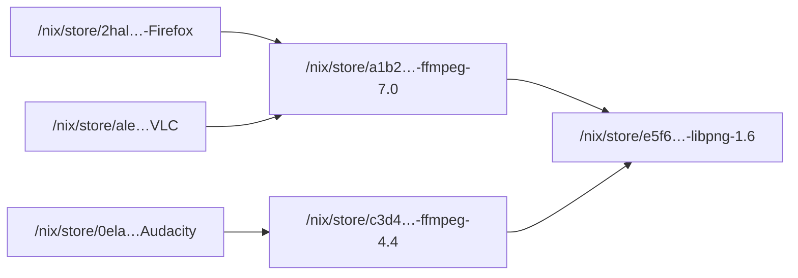

<div class="title-slide-wrapper">

  <div class="title-content">
    <h1>NixOS</h1>
    <h2>Alles, Überall, zur gleichen Zeit</h2>
    <p>
Reproduzierbare Systeme, Pakete und Entwicklungsumgebungen aus einer Konfiguration
</p>
  </div>
</div>


---

  <Toc :maxDepth="2"/>

---

# Einstieg: Raspberry Pi

<p>Simplifiziertes Beispiel, größeres Beispiel in Teams</p>
<p>Das gesamte System in einer Datei: `/etc/nixos/configuration.nix`</p>

```nix 
{ pkgs, ... }: {
  networking.hostName = "rpi";
  services.openssh.enable = true;

  users.users.inno = {
    isNormalUser = true;
    extraGroups = [ "wheel" ];
  };

  environment.systemPackages = with pkgs; [ vim git ];
}
```

- `nixos-rebuild switch` baut und aktiviert genau diesen Zustand
- Dieselbe Datei auf einem zweiten Pi ergibt dasselbe System

---

# Ursprung

## PhD-Thesis: The Purely Functional Software Deployment Model

- Eelco Dolstra, Universität Utrecht (NL), 2006<span class="ref">[1]</span>
- Idee: Software-Deployment wie eine **reine Funktion**
  - Eingabe: Quellcode, Abhängigkeiten, Build-Skript, Compiler
  - Ausgabe: Paket, abhängig nur von diesen Eingaben
- Gleiche Eingaben ergeben dasselbe Ergebnis
- Daraus entstanden: Nix (Paketmanager), Nixpkgs (Paketsammlung), NixOS (Betriebssystem)<span class="ref">[2]</span>

<div class="src">[1] <a href="https://edolstra.github.io/pubs/phd-thesis.pdf">Dolstra, PhD Thesis</a> · [2] <a href="https://en.wikipedia.org/wiki/Nix_(package_manager)">Wikipedia: Nix (package manager)</a></div>

---

# Prinzip und Vorteil

## Gegenüber einem Standard-Linux

<div class="grid grid-cols-2">
<div>

### Standard-Linux

- Pakete landen in `/usr`, `/lib`, `/etc`
- Ein Update überschreibt Dateien
- Zustand entsteht durch Historie
- Abbruch mitten im Update: halb-kaputtes System

</div>
<div>

### NixOS

- Jedes Paket liegt in `/nix/store/<hash>-name`, folgt nicht dem `Filesystem Hierarchy Standard`
- Updates legen vollständiges Neues daneben, Altes bleibt, keine halben Pakete
- Zustand entsteht aus der Konfiguration
- Rollback auf frühere Versionen per Boot-Menü

</div>
</div>

**Nutzen:** reproduzierbar, atomare Updates, Rollback, keine Abhängigkeitskonflikte

---

# Drei Dinge unter einem Namen

| Was | Rolle |
|---|---|
| **Nix-Sprache** | Funktionale, lazy ausgewertete Sprache für Konfiguration und Builds |
| **Nix** | Paketmanager: baut und verwaltet Pakete im Store |
| **NixOS** | Linux-Distribution, deren gesamtes System in Nix beschrieben ist |

- Nixpkgs ist ein Git-Repository und enthält Pakete und den NixOS-Quellcode<span class="ref">[2]</span>
- Als nix input kann jede beliebige url oder Datei genutzt werden.

<div class="src">[2] <a href="https://en.wikipedia.org/wiki/Nix_(package_manager)">Wikipedia: Nix (package manager)</a></div>

---

# Wie groß ist Nixpkgs?

<div>

  <div class="src">[13] <a href="https://repology.org/repositories/graphs"> Repology</a></div>
</div>


---

# Mehrere Versionen desselben Pakets

Jede Variante bekommt einen Hash über **alle** ihre Eingaben


```md
  /nix/store/b6gvzjyb2pg0kjfwrjmg1vfhh54ad73z-firefox-33.1
  |--------| |------------------------------| |----------|
store directory            hash                 name
```


- Kein „Dependency Hell“: Apps nutzen gleichzeitig verschiedene ffmpeg-Versionen
- Firefox und VLC teilen sich dieselbe Variante, nichts wird doppelt gespeichert
- Nicht mehr referenzierte Pfade räumt `nix-collect-garbage` ab

---

# Konfigurieren: System, Shell, Paket

<div class="grid grid-cols-3">
<div>

### nixsystem

```nix
# configuration.nix
{
  services.nginx.enable = true;
  networking.firewall
    .allowedTCPPorts = [ 80 ];
}
```

`nixos-rebuild switch`

</div>
<div>

### nixshell

```nix
# shell.nix
{ pkgs ? import <nixpkgs> {} }:
pkgs.mkShell {
  packages = [ pkgs.gcc pkgs.gdb ];
}
```

`nix-shell` / `nix develop`

</div>
<div>

### nixpackage

```nix
# default.nix
{ pkgs ? import <nixpkgs> {} }:
pkgs.stdenv.mkDerivation {
  name = "hello-app";
  src = ./.;
}
```

`nix-build`

</div>
</div>

- Shell und Paket funktionieren auch auf Nicht-NixOS-Systemen (linux, macOS, WSL), Nix lässt sich neben anderen Paketmanagern installieren<span class="ref">[2]</span>

<div class="src">[2] <a href="https://en.wikipedia.org/wiki/Nix_(package_manager)">Wikipedia: Nix (package manager)</a></div>

---

# Vergleich mit Docker

| Thema | Docker | Nix |
|---|---|---|
| **Stabilität** | Dockerfiles bauen nicht garantiert reproduzierbar, viele externe Abhängigkeiten | Alle Eingaben gepinnt (`flake.lock`) |
| **Plattform** | Probleme auf anderen CPU-Architekturen (z. B. Apple ARM) und mit USB-Durchreichung<span class="ref">[4]</span> | Pakete für mehrere Architekturen aus derselben Beschreibung |
| **Lizenz** | Docker Desktop Kommerzielle Lizenz, ab 250 Mitarbeitern oder $10 mio Umsatz p.a.<span class="ref">[5]</span> | Open Source |
| **Komplexität** | Daemon, Images, Layer, Registry | Eine Sprache, ein Store |
| **Performance** | Zusätzliche Container-Schicht | Läuft nativ, kein Overhead |

<div class="src">[4] <a href="https://github.com/docker/for-mac/issues/900">docker/for-mac #900</a> · [5] <a href="https://docs.docker.com/subscription/desktop-license/">Docker Desktop License</a></div>

---

# Wofür wird Nix verwendet?

| **Bereich** | **Beispiele** | **Problem** |
|---|---|---|
| **Cloud** | SysEleven, Flying Circus | Reproduzierbare Infrastruktur, Kubernetes-Deployments |
| **Entwicklerplattformen** | Google Project IDX, Replit, Flox | Jeder Entwickler braucht dieselbe Umgebung |
| **Finanzen** | Monzo, PDT Partners, D. E. Shaw | Reproduzierbare Builds, Auditierbarkeit, kontrollierte Änderungen |
| **Hardware / Embedded** | Anduril, Cyberus Technology, CircuitHub, Edgeless Systems | Komplexe Toolchains, lange Produktlebenszyklen |
| **Öffentliche Verwaltung** | DAWO (NL), DINUM (FR) | "Clarifying Lawful Overseas Use of Data Act" / CLOUD Act (USA) |
| **Forschung** | CERN (European Organization for Nuclear Research, FR) | Software-Verteilung und -Reproduzierbarkeit |

<div class="src">[2] <a href="https://en.wikipedia.org/wiki/Nix_(package_manager)">Wikipedia: Nix (package manager)</a> · [6] <a href="https://github.com/ad-si/nix-companies">ad-si/nix-companies</a>, <a href="https://discourse.nixos.org/t/list-of-companies-using-nixos-technologies/8428">NixOS Discourse: List of companies</a></div>

---

# Wie ausgewachsen ist Nix für ROS?

- **nix-ros-overlay** (Community): ROS-Pakete für Nix, unterstützt u. a. Humble (91%) und Jazzy (93%)<span class="ref">[7]</span>
- **ros2nix**: wandelt `package.xml` automatisch in Nix-Ausdrücke um<span class="ref">[8]</span>
- **nix-ros-workspace**: Builder für ROS-2-Workspaces<span class="ref">[9]</span>
- **jetpack-nixos** (Anduril): NixOS auf NVIDIA-Jetson-Geräten<span class="ref">[7]</span>
- **Clearpath Robotics** stellte einen Nix-Ansatz für ROS auf der ROSCon 2022 vor: "4.5 times faster with 10% of the resources!"<span class="ref">[10]</span>

<div v-click class="mt-4">
<b>Einschätzung:</b> gut nutzbar, aber community-getragen und kein offizieller ROS-Weg, <code>/opt/ros</code> ersetzt man nicht ohne Aufwand

<blockquote>
General cost/benefit/risk of a large system migration (no matter the technology) vs other software and infrastructure investments we could be making

Familiarity of Nix vs. alternatives among our team and the general ROS/software development community

Support of Nix by the various other tools in our CI system (not just build tools, but analysis tools, audit tools and the like)

All of this is to say that I’m not aware of any technical reason your ambitious idea might not work.  -- Ryan Gariepy OSRF Board Member<span class="ref">[11]</span>
</blockquote>
</div>

<div class="src">[7] <a href="https://github.com/lopsided98/nix-ros-overlay">nix-ros-overlay</a> · [8] <a href="https://github.com/wentasah/ros2nix">wentasah/ros2nix</a> · [9] <a href="https://github.com/hacker1024/nix-ros-workspace">hacker1024/nix-ros-workspace</a> · [10] <a href="https://github.com/clearpathrobotics/nix-ros-base">clearpathrobotics/nix-ros-base</a> · [11] <a href="https://discourse.openrobotics.org/t/build-systems-package-management-and-nix/41488/24">lange technische Forum Diskussion</a></div>

---

# Fazit

- **Eine Beschreibung, ein Ergebnis:** System, Shell und Paket reproduzierbar
- **Sicher ändern:** atomare Updates, Rollback, parallele Versionen
- **Gegenüber Docker:** weniger bewegliche Teile, nativ, freie Lizenz
- **Preis:** steile Lernkurve und eine eigene Sprache

---

# Quellen

<div class="src" style="font-size: 0.85rem; line-height: 1.4;">

1. E. Dolstra: *The Purely Functional Software Deployment Model*, PhD Thesis, Utrecht University, 2006, <https://edolstra.github.io/pubs/phd-thesis.pdf>
2. Wikipedia: *Nix (package manager)*, <https://en.wikipedia.org/wiki/Nix_(package_manager)>
3. Repology: *Graphs*, <https://repology.org/repositories/graphs>; NixOS Discourse: *Nixpkgs has been the largest repository for months*, <https://discourse.nixos.org/t/nixpkgs-has-been-the-largest-repository-for-months/10667>
4. Docker for Mac, Issue #900, <https://github.com/docker/for-mac/issues/900>
5. Docker Desktop License, <https://docs.docker.com/subscription/desktop-license/>
6. <https://github.com/ad-si/nix-companies>; NixOS Discourse: *List of companies using NixOS technologies*, <https://discourse.nixos.org/t/list-of-companies-using-nixos-technologies/8428>
7. lopsided98/nix-ros-overlay, <https://github.com/lopsided98/nix-ros-overlay>; 
8. wentasah/ros2nix, <https://github.com/wentasah/ros2nix>
9. hacker1024/nix-ros-workspace, <https://github.com/hacker1024/nix-ros-workspace>
10. clearpathrobotics/nix-ros-base, <https://github.com/clearpathrobotics/nix-ros-base>
11. forum diskussion, <https://discourse.openrobotics.org/t/build-systems-package-management-and-nix/41488/24>
12. anduril/jetpack-nixos, <https://github.com/anduril/jetpack-nixos>; amarrmb: *NixOS for Robotics*, <https://amarrmb.github.io/robotics-glossary/software/embedded/nixos>
13. repology, <https://repology.org/repositories/graphs>

ROS nix blogs: 
- <https://platonic.systems/blog/nix-for-robotics/>
- <https://index.0x77.dev/blog/ros-devenv>

</div>
